# The Hive Below: art brief for the image model

This folder is the source art for the third DEAD ZONE story, an underground insect hive. It follows the same
conventions as `art/source/zombies-pixel` and `art/source/bosses-pixel`: one transparent PNG sprite sheet per
creature, on a fixed grid, which the game's art build cuts into frames. The full design is in
[`notes/hive-below.md`](../../../notes/hive-below.md). This file is everything needed to paint the art.

Nate signed the plan off on 2026-11-11. All 44 source images are now painted. See [IMPLEMENTATION.md](IMPLEMENTATION.md) for atlas files, animation names, preview controls, and rebuild instructions.

## What to deliver

44 images, saved with exactly these names in this folder:

| What | Count | File name | Canvas | Layout |
|---|---|---|---|---|
| Enemy sheets | 11 | `<type>-0.png`, for example `drone-0.png` | 2:1, ideally 2048 x 1024 | 8 x 4 grid, 29 poses |
| Boss sheets | 6 | `boss-<id>.png` | square, ideally 2048 x 2048 | 4 x 4 grid, 16 poses |
| Queen sheets | 2 | `boss-queen-court.png`, `boss-queen-unbound.png` | square, ideally 2048 x 2048 | 4 x 4 grid, 16 poses each |
| Weapon icons | 11 | `icons/<id>.png` | 768 x 768 | one object, side view |
| Held weapons | 11 | `held/<id>.png` | 1024 x 512 | one object, top-down |
| Item icons | 3 | `icons/<id>.png` | 768 x 768 | one object |

The importer reads each PNG's real size, so any size works as long as the proportions and the grid are exact.
A second variant of the two commonest enemies (`drone-1.png`, `hopper-1.png`: same sheet, different wear and
markings) is welcome but not required.

## Rules for every creature

- **Camera:** straight down from directly above. You see the creature's back, with legs splayed to the sides.
- **Facing:** every pose faces right. Head on the right, abdomen on the left. The game rotates the sprite.
- **Subject:** giant dead insects on six legs, the size of a person. Not humanoids. Dull chipped chitin, cracks, rot patches, frayed wings.
- **Signature:** small glowing violet eyes, `#c9a6ff`, on every creature. Lit in living frames, dark in the corpse.
- **Style:** crisp pixel art matching the painted zombie and boss sheets already in this repo. Dark outlines, limited palette, light from the upper left.
- **Background:** true alpha transparency. No floor, shadow, checkerboard, text, grid lines or borders.
- **Scale and anchor:** the same body scale and the same centre point in every cell of a sheet. Enemies stay inside the central 70% of the cell, bosses inside 80%.
- **No loose effects:** sprays, darts, honey pools, dust clouds beyond a few motes, and steam are drawn by the game.

Sizes between sheets do not need to match. The importer scales each creature to its in-game radius, listed below.

## References to attach

- **Style** (how it should be painted): `art/source/zombies-pixel/walker-0.png`, `brute-0.png`, `bloater-0.png`, `runner-0.png`, `crawler-0.png`; `art/source/bosses-pixel/butcher.png`, `warden.png`; for icons `public/assets/story-icons/pistol.png`, `machete.png`, `military_vest.png`.
- **Design** (what to paint): the images in [`concepts/`](concepts/). They are drawn by code at low resolution, facing right like the sheets. They fix each creature's silhouette, anatomy, colours and markings. They are not the finish to aim for; the style references are.
- **Relative size:** [`concepts/scale-enemies.png`](concepts/scale-enemies.png) and [`concepts/scale-bosses.png`](concepts/scale-bosses.png).

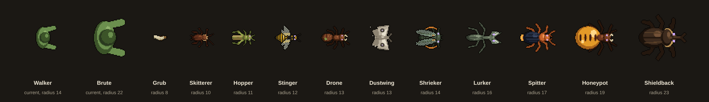

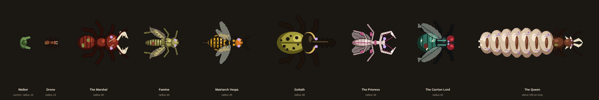

## Enemy sheet layout (8 x 4)

The same grid as the current zombies, with one addition: four "special" frames in row 4.

| Row | Cells | Frames |
|---|---|---|
| 1 | 1-8 | Walk 0-7 (fliers: wing-beat cycle) |
| 2 | 1-6 | Attack 0-5: wind-up, rear back, lunge, strike, retract, recover |
| 2 | 7-8 | Hit 0-1: recoil, recovery |
| 3 | 1-8 | Death 0-7, ending motionless on its back or side |
| 4 | 1 | Corpse: death frame 7, eyes dark, small ichor stain |
| 4 | 2-5 | Special 0-3: the creature's signature move, described per enemy below |
| 4 | 6-8 | Empty |

## Boss sheet layout (4 x 4)

The same grid as the current bosses.

| Row | Cell 1 | Cell 2 | Cell 3 | Cell 4 |
|---|---|---|---|---|
| 1 | idle 1 | idle 2 | walk, left step | walk, passing |
| 2 | walk, right step | walk, passing alternate | melee wind-up | melee strike |
| 3 | special preparation 1 | special preparation 2 | special release 1 | special release 2 |
| 4 | hit recoil | death start | death middle | dead, lying flat |

The Queen has two sheets with their own cell lists, given in her section.

## Order of work

The game is built in four playable steps. Art for a step is only needed when that step is built, so paint in this order.

**Step 1:** Drone, Honeypot, Grub, The Marshal, Formic Sprayer (icon and held), Mandible Shears (icon and held), ichor (icon), royal jelly (icon).

**Step 2:** Hopper, Shrieker, Stinger, Famine, Matriarch Vespa, Locust Repeater (icon and held), Needler (icon and held), The Vespiary (icon and held).

**Step 3:** Spitter, Shieldback, Lurker, Dustwing, Goliath, The Prioress, Bombardier (icon and held), Hornbreaker (icon and held), Lure Lantern (icon and held), Mantis Scythes (icon and held), carapace vest (icon).

**Step 4:** Skitterer, The Carrion Lord, The Queen (fixed in place), The Queen (unbound), Carrion Hive (icon and held), Queen's Decree (icon and held).

## Enemies

### Drone (worker ant)

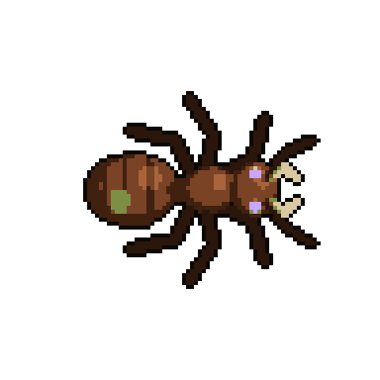

- **Deliver:** `drone-0.png`. Imported at 128 px frames. In-game radius 13.
- **Attach:** `art/source/zombies-pixel/walker-0.png` (style), `concepts/enemy-drone.png` and `concepts/enemy-drone-walk.png` (design).
- **Look:** Worker ant the size of a person. Three clear body segments: a round head with short open bone-white mandibles and elbowed antennae, a narrow thorax, and a large oval abdomen with faint darker bands. Six thin dark legs splayed from the thorax. Rust-brown chitin (#7a4326, highlight #a8643c, shadow #40200f), near-black legs (#2b160b). Signs of death: a patch of grey-green rot (#7d8f45) on the abdomen, hairline cracks, one antenna shorter than the other.
- **Walk:** Brisk tripod gait, antennae twitching.
- **Attack:** Lunging bite, mandibles snapping shut.
- **Death:** Legs fold, it tips onto its side and then its back.
- **Special:** ALARM. It rears the front of its body, antennae raised and spread wide, mandibles open, held with a slight tremble.
- **In the game:** Alarm pheromone. The first drone to see you marks you. Every drone within 600 px joins in and none of them lose your trail for 12 seconds. Five or more together move 20% faster.


### Hopper (locust)

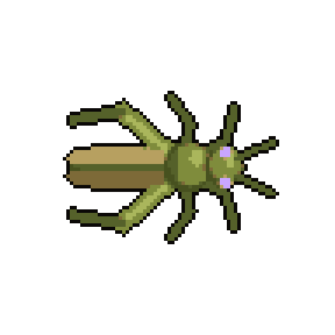

- **Deliver:** `hopper-0.png`. Imported at 128 px frames. In-game radius 11.
- **Attach:** `art/source/zombies-pixel/runner-0.png` (style), `concepts/enemy-hopper.png` and `concepts/enemy-hopper-walk.png` (design).
- **Look:** Locust. Long narrow body: a small head with short thread antennae, a saddle-shaped plate behind the head, and a long tapered abdomen covered by folded tan wings (#b7a060 and #7d6a38). Oversized jumping hind legs: thick olive thighs angled back and out, thin shins. Small front and middle legs. Olive green (#7f8c3c, highlight #aab65c, shadow #47511f). Signs of death: frayed wing tips, dull colour.
- **Walk:** Short quick steps on the four front legs while the big hind legs ride along folded.
- **Attack:** Kicks forward and bites.
- **Death:** Legs give way, rolls onto its back, hind legs kick and curl.
- **Special:** LEAP. Deep crouch, launch, airborne with the hind legs stretched out behind and the wings half open, landing crouch.
- **In the game:** Leap. Jumps up to 280 px over other bugs and low cover to land beside you, every 2.5 seconds. It can be shot in the air.


### Honeypot (honeypot ant)

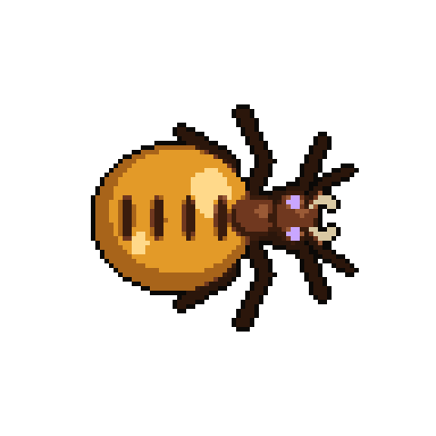

- **Deliver:** `honeypot-0.png`. Imported at 192 px frames. In-game radius 19.
- **Attach:** `art/source/zombies-pixel/bloater-0.png` (style), `concepts/enemy-honeypot.png` and `concepts/enemy-honeypot-walk.png` (design).
- **Look:** Honeypot ant. A tiny dark-brown head and thorax in front of an enormous, swollen, glossy amber abdomen, nearly spherical and three times the width of the head. The old dark armour plates are stretched apart into four small bars along the top of the abdomen. Abdomen amber #e39a28, highlight #ffd98a, shadow #a8641a, translucent with one bright specular highlight. Spindly legs that barely carry it.
- **Walk:** Slow waddle, the abdomen dragging and wobbling.
- **Attack:** Weak bite, abdomen swinging.
- **Death:** The abdomen splits and deflates. The corpse is an empty wrinkled amber skin behind the small body. Do not draw the honey pool; the game draws it.
- **Special:** PULSE. The abdomen swells and brightens a little more in each frame.
- **In the game:** Honey burst. Bursts on death into a pool of honey, 110 px across for 7 seconds, that halves movement speed. Yours and the bugs'.


### Shrieker (cicada)

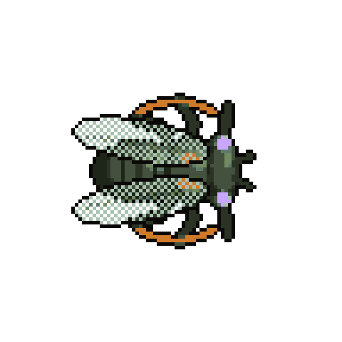

- **Deliver:** `shrieker-0.png`. Imported at 128 px frames. In-game radius 14.
- **Attach:** `art/source/zombies-pixel/walker-0.png` (style), `concepts/enemy-shrieker.png` and `concepts/enemy-shrieker-walk.png` (design).
- **Look:** Cicada. Stout, broad body: a wide flat head with the eyes far apart at its corners, a broad thorax with two orange markings (#cf7a2a), a tapering banded abdomen. Two long clear wings with dark veins lie roof-like along the sides and reach past the abdomen (pale grey-green #a9c2b0, see-through). Dark green-black chitin (#44513e, highlight #718a62, shadow #1e261a). Short legs.
- **Walk:** Slow heavy walk, wings folded.
- **Attack:** Headbutt.
- **Death:** Rolls onto its back, wings splayed, legs curl.
- **Special:** CHORUS wind-up. It arches its back, the wings lift slightly, and the two orange markings glow brighter each frame; the body visibly vibrates in the last two frames.
- **In the game:** Chorus. Hangs back. After a 1.2 second wind-up it screams: every bug within 900 px comes for you and moves 25% faster for 6 seconds. Your flashlight flickers.


### Stinger (wasp)

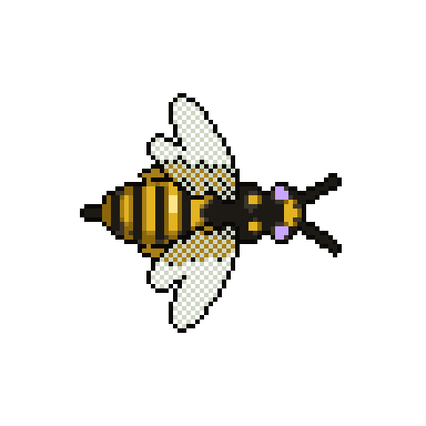

- **Deliver:** `stinger-0.png`. Imported at 128 px frames. In-game radius 12.
- **Attach:** `art/source/zombies-pixel/runner-0.png` (style), `concepts/enemy-stinger.png` and `concepts/enemy-stinger-walk.png` (design).
- **Look:** Wasp, always airborne. Narrow waist. Black head with a yellow face, black thorax with two yellow dots, a tapered abdomen in yellow (#e3b322) and black (#1d1a15) bands ending in a long black sting. Two pairs of clear wings swept back. Thin legs dangling underneath. Never show it standing on the ground while alive.
- **Flight:** HOVER instead of a walk: an 8-frame wing-beat cycle with the wings as blurred fans, legs dangling, a slight bob.
- **Attack:** The abdomen curls forward under the body and jabs the sting to the right.
- **Death:** Wings stop, it drops and lies on its side with crumpled wings.
- **Special:** DIVE. Body tilted forward, wings swept back, sting leading.
- **In the game:** Flight and venom. Flies over pits, low cover and other bugs. Each sting adds a venom stack: 3 damage a second for 4 seconds, up to 3 stacks.


### Spitter (bombardier beetle)

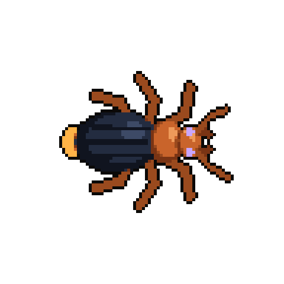

- **Deliver:** `spitter-0.png`. Imported at 128 px frames. In-game radius 17.
- **Attach:** `art/source/zombies-pixel/walker-0.png` (style), `concepts/enemy-spitter.png` and `concepts/enemy-spitter-walk.png` (design).
- **Look:** Bombardier beetle. Small orange head and orange plate behind it (#c9642b, highlight #ee9a5a), blue-black ridged wing cases with a centre seam (#232c40, highlight #3d4a66), orange legs, long thread antennae. The tip of the abdomen glows orange-hot (#ffb347).
- **Walk:** Steady beetle walk.
- **Attack:** Close bite (it mostly sprays).
- **Death:** Flips onto its back, legs curl; the glow at the abdomen tip goes out.
- **Special:** SPRAY TELL. It plants all six legs wide and swings the abdomen tip forward underneath itself so it points right. The tip goes from orange to white-hot across the frames, with a few wisps of steam. Do not draw the spray; the game draws it.
- **In the game:** Boiling spray. Plants its legs at 220 px and, after a 0.6 second tell, fires a 60° cone of scalding spray. The puddle burns for 2 seconds.


### Shieldback (rhinoceros beetle)

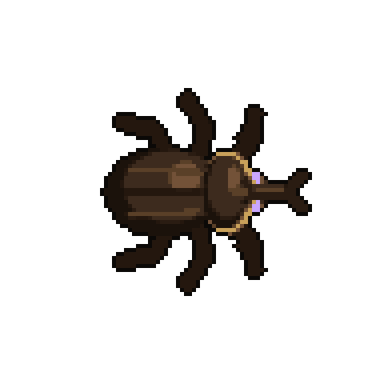

- **Deliver:** `shieldback-0.png`. Imported at 192 px frames. In-game radius 23.
- **Attach:** `art/source/zombies-pixel/brute-0.png` (style), `concepts/enemy-shieldback.png` and `concepts/enemy-shieldback-walk.png` (design).
- **Look:** Rhinoceros beetle, the biggest ordinary enemy. Heavy oval body in glossy dark brown-black (#3d2b1e, highlight #735238, shadow #1b120b). A wide armoured plate behind the head with a pale bronze rim (#c9a15a) along its front edge; that rim is how players read "armoured from the front", so keep it bright. A long forked horn projecting forward from the head. Thick spurred legs.
- **Walk:** Heavy slow walk.
- **Attack:** Upward toss of the horn.
- **Death:** Sinks, tips onto its side, lies on its back with legs curled and horn pointing right.
- **Special:** CHARGE. Head down so the horn is level and pointing right, legs at full stretch, a 4-frame gallop.
- **In the game:** Front plate and charge. Shots to its front do 20% damage. It lowers its horn and charges in a straight line at 300 speed, shoving other bugs aside.


### Lurker (praying mantis)

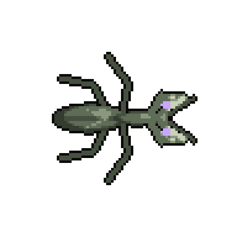

- **Deliver:** `lurker-0.png`. Imported at 128 px frames. In-game radius 16.
- **Attach:** `art/source/zombies-pixel/walker-0.png` (style), `concepts/enemy-lurker.png` and `concepts/enemy-lurker-walk.png` (design).
- **Look:** Praying mantis. Slender: a triangular head with large eyes at its two rear corners, a long thin neck, a long leaf-shaped abdomen with a centre vein. Two raptorial forearms folded in front of the head, edged with pale spines. Four thin walking legs. Stone grey-green camouflage colours (#5f6c57, highlight #8b987f, shadow #333c2f) so it blends with cave rock. Paint it fully opaque; the game fades it when it hides.
- **Walk:** Slow stalking steps with a side-to-side sway, forearms folded.
- **Attack:** Both forearms snap out to the right and close like a trap.
- **Death:** Folds up, falls on its side, forearms curled in.
- **Special:** LUNGE. Body low and stretched long, forearms going from cocked to fully extended ahead.
- **In the game:** Camouflage. Stands motionless against a wall, almost invisible until your flashlight beam is on it or you come within 170 px. Then it lunges at 320 speed. It is exposed for 1.5 seconds after a miss.


### Dustwing (moth)

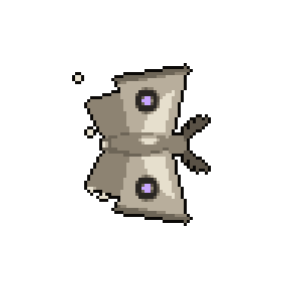

- **Deliver:** `dustwing-0.png`. Imported at 128 px frames. In-game radius 13.
- **Attach:** `art/source/zombies-pixel/walker-0.png` (style), `concepts/enemy-dustwing.png` and `concepts/enemy-dustwing-walk.png` (design).
- **Look:** Moth, always airborne. Broad triangular forewings spread flat in a delta shape, each with a dark eye-spot ring and a small violet centre; smaller hindwings; a furry grey-brown body; feathery antennae. Pale ash colours (#b8ae9c, highlight #e6dfcd, shadow #6d6557). A few pale dust motes trail from the wings.
- **Flight:** FLAP instead of a walk: an 8-frame wing cycle from fully spread to half closed and back.
- **Attack:** Body-slam with the wings wrapping forward.
- **Death:** Wings fold, it spirals down and lies flat with wings spread.
- **Special:** DUST BURST. The wings clap together above the body and a ring of pale dust puffs outward.
- **In the game:** Drawn to light. Homes on your flashlight. Switch it off and it loses you in 2 seconds. If it reaches you or dies close by, its dust cuts your beam's range by 40% for 6 seconds.


### Skitterer (cockroach)

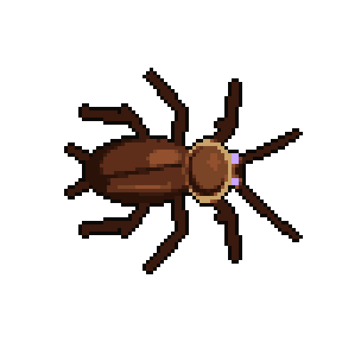

- **Deliver:** `skitterer-0.png`. Imported at 128 px frames. In-game radius 10.
- **Attach:** `art/source/zombies-pixel/runner-0.png` (style), `concepts/enemy-skitterer.png` and `concepts/enemy-skitterer-walk.png` (design).
- **Look:** Cockroach. Flat oval body in glossy dark red-brown (#5e2e1b, highlight #93502e, shadow #2a1209). A shield behind the head with a pale tan margin (#c9a36a) hides most of the head. Overlapping wings on the back, very long antennae sweeping forward, six spiny legs splayed wide, two short tail spikes.
- **Walk:** Very fast scuttle: legs in sharply alternating positions, antennae whipping.
- **Attack:** Quick bite.
- **Death:** Flips onto its back, legs kick, then curl.
- **Special:** GETS BACK UP. On its back with legs kicking, rocking, flipping over, upright again.
- **In the game:** Light-shy, hard to kill. Runs out of your beam and circles round to come at you from the dark. One in three gets back up after 2 seconds unless it died to fire, acid or an explosion.


### Grub (larva)

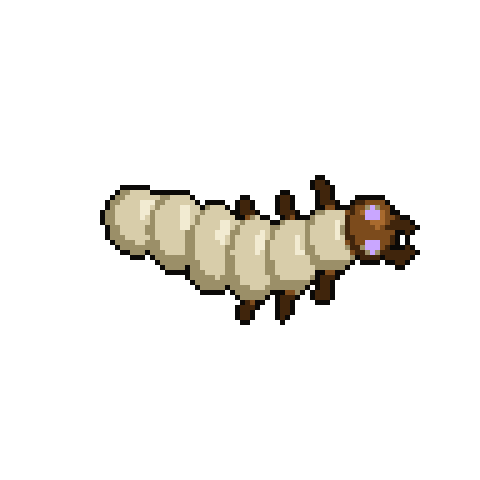

- **Deliver:** `grub-0.png`. Imported at 128 px frames. In-game radius 8.
- **Attach:** `art/source/zombies-pixel/crawler-0.png` (style), `concepts/enemy-grub.png` and `concepts/enemy-grub-walk.png` (design).
- **Look:** Larva. Six pale cream segments (#d8cdaa, highlight #f2ebd2, shadow #9b8f68), fattest in the middle, with a small dark amber head capsule (#7c4b1c) and tiny mandibles. Three pairs of stubby legs near the head.
- **Walk:** S-curve wriggle, the wave travelling from head to tail.
- **Attack:** Small lunge with the head.
- **Death:** Curls into a C and goes still.
- **Special:** BURROW. Head down into the ground, the body sinking until only the tail shows.
- **In the game:** Metamorphosis. Hatches from egg clusters and infested corpses. A grub left alive for 25 seconds burrows and comes back as a random adult.


## Bosses

### The Marshal (soldier ant, boss of The Warrens)

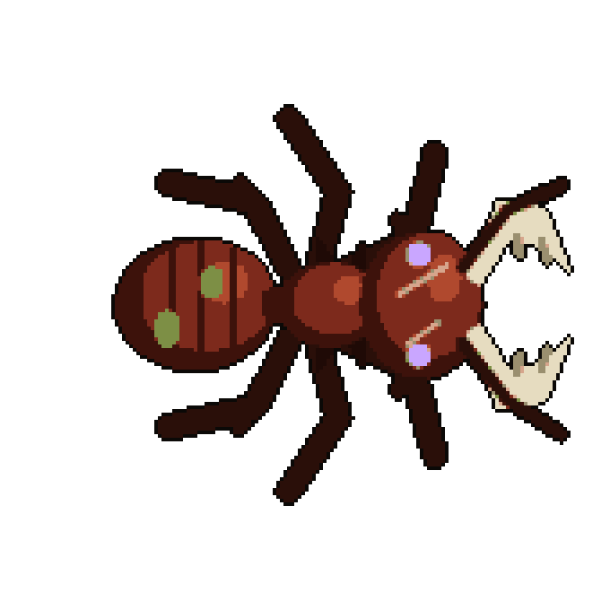

- **Deliver:** `boss-marshal.png`. Imported at 192 px cells. In-game radius 40.
- **Attach:** `art/source/bosses-pixel/butcher.png` (style), `concepts/boss-marshal.png` (design).
- **Look:** Soldier ant major, colossal. An oversized blocky head, wider than the thorax, with huge serrated bone-white siege mandibles (#e6dcc0) as long as the head itself. Dark blood-red chitin (#7d2a1c, highlight #b0492e, shadow #3d120b). Backward-pointing spikes on the thorax. Banded abdomen with patches of grey-green rot. Thick spurred legs. Pale scars across the head.
- **Melee cells:** The mandibles open wide, then snap shut ahead of it.
- **Special preparation cells:** JAW CHARGE. Head lowered, mandibles spread to their widest, legs braced.
- **Special release cells:** At a full gallop, mandibles thrust forward.
- **In the game:** Jaw charge, Rally, Formic arc. Below half health it charges twice in a row.


### Famine (locust, boss of The Granary)

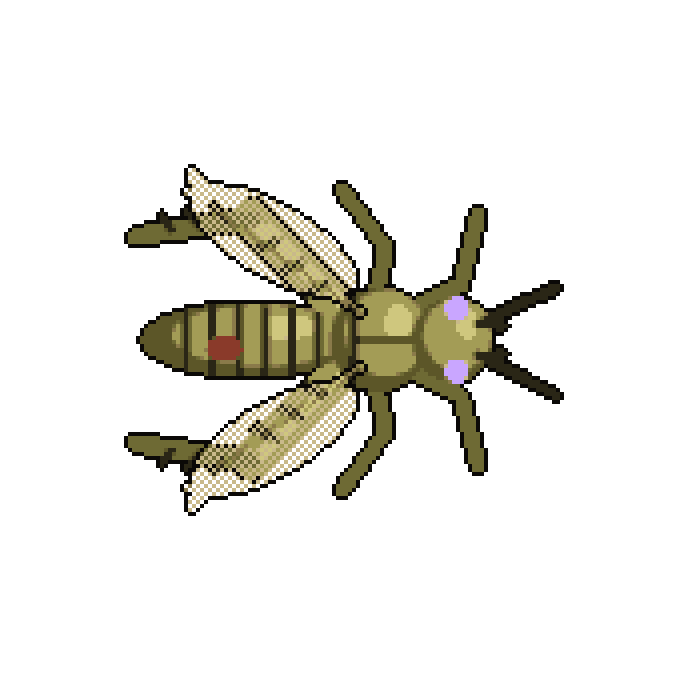

- **Deliver:** `boss-famine.png`. Imported at 192 px cells. In-game radius 34.
- **Attach:** `art/source/bosses-pixel/butcher.png` (style), `concepts/boss-famine.png` (design).
- **Look:** Giant locust, emaciated. A long gaunt body in pale yellow-grey (#a39c56, highlight #cfc77e, shadow #5c5628) with black banding on the abdomen and thighs. Enormous hind legs. Tattered see-through wings half spread. Dark mouthparts.
- **Melee cells:** A forward kick with a hind leg, then a bite.
- **Special preparation cells:** SKYFALL. A deep crouch on the hind legs.
- **Special release cells:** Airborne: legs trailing, tattered wings fully open.
- **In the game:** Skyfall, Swarm front, Strip. Below half health it leaps three times in a row.


### Matriarch Vespa (hornet, boss of The Paper Hive)

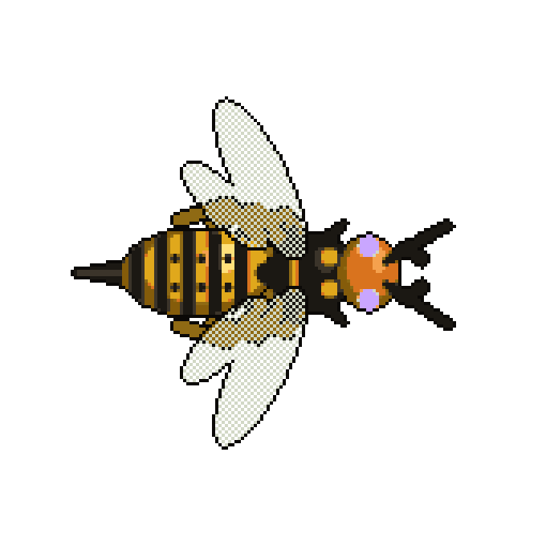

- **Deliver:** `boss-vespa.png`. Imported at 192 px cells. In-game radius 36.
- **Attach:** `art/source/bosses-pixel/butcher.png` (style), `concepts/boss-vespa.png` (design).
- **Look:** Giant hornet matriarch, airborne. An orange head (#d9731e) with heavy mandibles, a black thorax with crown-like spikes, a long abdomen banded in yellow (#e0a81c) and black with a very long sting. Two pairs of large clear wings.
- **Melee cells:** A jab of the sting.
- **Special preparation cells:** STRAFING RUN. The abdomen swings forward underneath the body.
- **Special release cells:** The abdomen points right, firing. Do not draw the darts; the game draws them.
- **Note:** She hovers: use the two idle cells and the four walk cells for a wing-beat and drift cycle with blurred wings. In the death cells she falls and lies with crumpled wings.
- **In the game:** Strafing run, Venom volley, Hatch. Below half health she lands and adds an impaling dash.


### Goliath (Hercules beetle, boss of The Boiling Galleries)

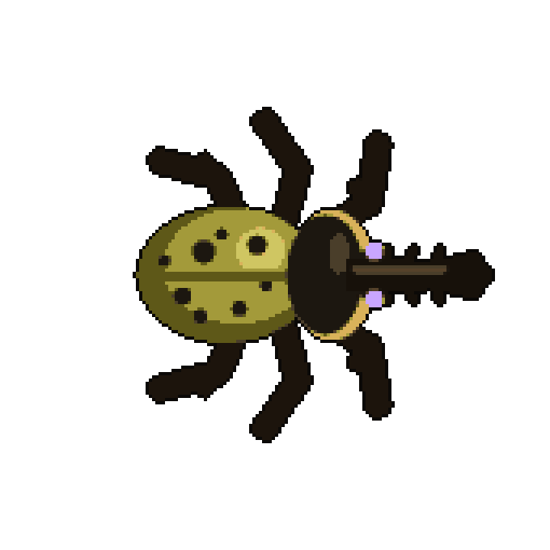

- **Deliver:** `boss-goliath.png`. Imported at 192 px cells. In-game radius 48.
- **Attach:** `art/source/bosses-pixel/butcher.png` (style), `concepts/boss-goliath.png` (design).
- **Look:** Hercules beetle, the largest brood boss. A black armoured plate behind the head with a bronze rim (#d9b25a), olive-yellow wing cases with black spots (#a39a3a), and a very long toothed horn projecting forward over a shorter head horn, so the two read as a pincer from above. Massive spurred legs.
- **Melee cells:** An upward toss of the horn.
- **Special preparation cells:** RAM. Head down, front legs pawing.
- **Special release cells:** Full charge with the horn level.
- **In the game:** Ram, Boiling vent, Shell quake. Below half health the pillars shatter on the first hit, so each one only saves you once.


### The Prioress (praying mantis, boss of The Lantern Deep)

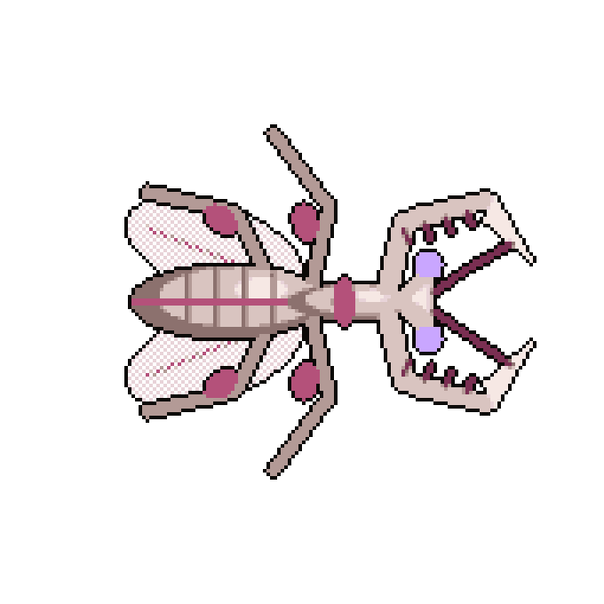

- **Deliver:** `boss-prioress.png`. Imported at 192 px cells. In-game radius 34.
- **Attach:** `art/source/bosses-pixel/butcher.png` (style), `concepts/boss-prioress.png` (design).
- **Look:** Giant mantis in orchid-mantis colours: bone pink (#d9c4c0, highlight #f6e8e4, shadow #8c716e) with magenta accents (#b4517a). A triangular head, a long neck, petal-shaped lobes on the walking legs, pale wings half open like a cloak, and two long scythe forearms held wide.
- **Melee cells:** REAP: a wide sweep of one scythe across the front.
- **Special preparation cells:** SCYTHE CROSS. Both arms cocked back high.
- **Special release cells:** Both scythes slash forward and cross in an X, the body stretched long.
- **In the game:** Vanish, Scythe cross, Reap, Vespers. Below half health she strikes twice each time she vanishes.


### The Carrion Lord (blowfly, boss of The Rot Cellar)

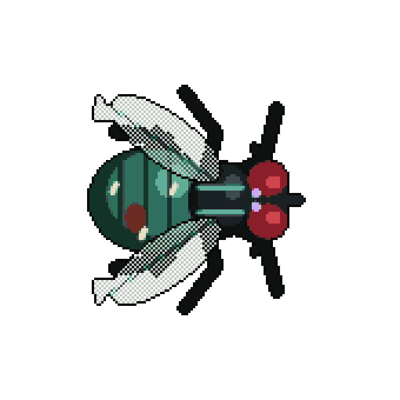

- **Deliver:** `boss-carrion_lord.png`. Imported at 192 px cells. In-game radius 42.
- **Attach:** `art/source/bosses-pixel/butcher.png` (style), `concepts/boss-carrion_lord.png` (design).
- **Look:** Bloated blowfly. A swollen metallic green-teal abdomen (#2f6f5e, highlight #5fae96) with banding, an open wound, and pale maggots crawling on it. A dark bristled thorax with two pale stripes. Huge dark-red compound eyes (#8a1f2a). A short proboscis. Tattered clear wings swept back. Six hairy black legs.
- **Melee cells:** A stab with the proboscis.
- **Special preparation cells:** INFEST. The abdomen is raised high.
- **Special release cells:** The abdomen tip thrusts down and forward. No loose eggs or projectiles.
- **Note:** It crawls and buzzes: the walk cells are a heavy crawl with the wings buzzing.
- **In the game:** Infest, Bile flood, Buzz dash, Stench. Below half health carcasses fall from the roof, giving it more to infest.


### The Queen (final boss)

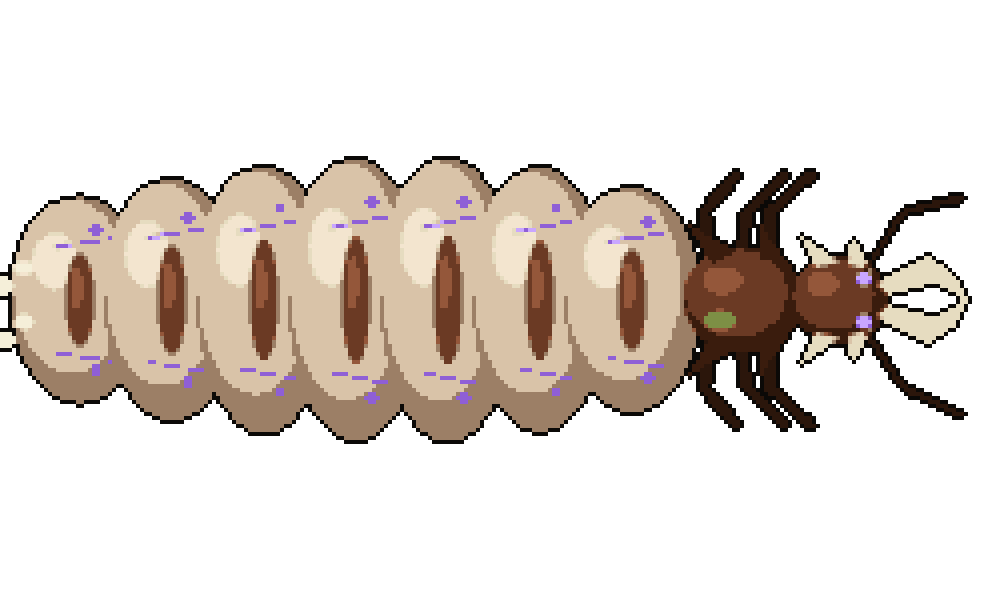

She has two bodies, so two sheets. Both are imported at 384 px cells, like the Warden.

- **Look:** Termite and ant queen in one. A small dark-brown armoured head and thorax (#6b3a24, highlight #94573a) with bone-white crown ridges and long mandibles, in front of an enormous pale egg sac of seven swollen cream-pink segments (#d9c3a8, highlight #f3e5cf, shadow #9c7f66). The old brown armour plates are stretched apart into one small bar on top of each segment. Faint violet veins and glowing violet spots (#8f5fd6) along both sides. Six small legs around the thorax, too small to carry her. She is about fourteen times the length of a Drone.
- **Attach:** `art/source/bosses-pixel/warden.png` (style), `concepts/boss-queen.png` (design).

**`boss-queen-court.png`**: stages 1 and 2, fixed in place with her egg sac. The 16 cells, in order:

1. Idle, sac pulsing 1
2. Idle, sac pulsing 2
3. Idle, sac pulsing 3
4. Idle, sac pulsing 4
5. Laying a clutch 1 (eggs emerging at the rear, left side)
6. Laying a clutch 2
7. Egg-bomb lob wind-up (rear of the sac contracts)
8. Egg-bomb lob release
9. Foreleg slam wind-up (front legs raised)
10. Foreleg slam strike
11. Pheromone command wind-up (antennae raised, violet spots brighter)
12. Pheromone command release (violet spots at their brightest)
13. Hit recoil
14. Tearing free 1 (the membrane splits behind the thorax)
15. Tearing free 2 (thorax pulling away)
16. The empty torn sac alone, left behind

**`boss-queen-unbound.png`**: stages 3 and 4. The same queen torn free of her egg sac: the head and thorax, and a short ragged stump of abdomen trailing torn membrane. Her legs are now long enough to carry her. Mandibles wide. Violet light leaks from the wound. Standard boss grid; the special cells are her charge (crouch, scream, release, full gallop).


## Weapons

Each weapon needs two images: an **icon** (side view, for the inventory and HUD, in the style of `public/assets/story-icons`) and a **held sprite** (top-down, in the player's hands, in the style of the `weapon_*` frames in `public/assets/characters.png`).

### Formic Sprayer

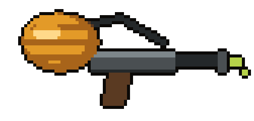

- **Deliver:** `icons/formic_sprayer.png` and `held/formic_sprayer.png`. Primary slot. The held sprite ends up about 110 px long in the game's atlas (the pistol is 46, the shotgun 116, the hunting rifle 137).
- **Look:** A sprayer built around an ant's amber abdomen used as the tank: glossy, banded amber, mounted on the top rear of a short grey metal body. A hose runs from the tank to a dark nozzle. Brown pistol grip. A drip of yellow-green acid at the nozzle.
- **In the game:** A stream of acid out to 240 px. Every hit adds a corrosion stack that keeps burning. Four stacks strip a Shieldback's plate.


### Mandible Shears

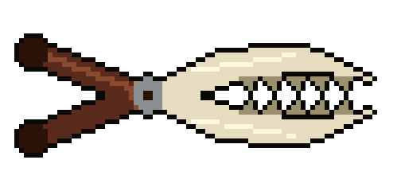

- **Deliver:** `icons/mandible_shears.png` and `held/mandible_shears.png`. Melee slot. The held sprite ends up about 100 px long in the game's atlas (the pistol is 46, the shotgun 116, the hunting rifle 137).
- **Look:** Two serrated bone-white soldier-ant mandibles hinged like shears on a steel bolt, with two dark red-brown wrapped handles.
- **In the game:** A heavy snap in a narrow arc. A kill cuts through to two more bugs behind it. Ignores armour plates.


### Locust Repeater

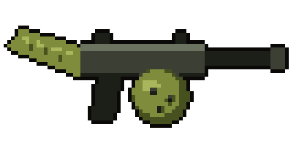

- **Deliver:** `icons/locust_repeater.png` and `held/locust_repeater.png`. Primary slot. The held sprite ends up about 90 px long in the game's atlas (the pistol is 46, the shotgun 116, the hunting rifle 137).
- **Look:** A submachine gun with a dull olive-metal body. The stock is a locust thigh, green with dark notches. A round green drum magazine under the body. Short dark barrel.
- **In the game:** Fast automatic. Every shot hops on to two more bugs within 140 px at 60% damage.


### Needler

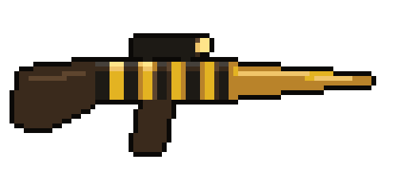

- **Deliver:** `icons/needler.png` and `held/needler.png`. Primary slot. The held sprite ends up about 140 px long in the game's atlas (the pistol is 46, the shotgun 116, the hunting rifle 137).
- **Look:** A long rifle: dark wooden stock, black receiver with four yellow bands like a wasp's abdomen, a small scope, and a barrel that is a long tapering amber wasp sting.
- **In the game:** A semi-automatic rifle. Needles pass through three bugs and inject venom, 30 damage over 4 seconds.


### The Vespiary

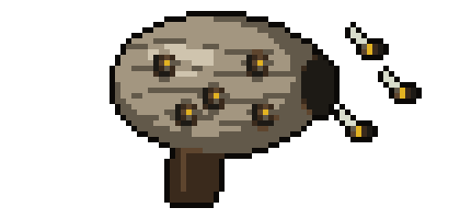

- **Deliver:** `icons/vespiary.png` and `held/vespiary.png`. Sidearm slot. The held sprite ends up about 64 px long in the game's atlas (the pistol is 46, the shotgun 116, the hunting rifle 137).
- **Look:** A grey-tan paper wasp nest the size of a football, with horizontal paper banding and several dark cell holes with yellow hornet faces looking out, mounted on a brown pistol grip. An opening at the front. Two or three hornets in the air beside it (icon only).
- **In the game:** Fires hornets that home on the nearest bug. It breeds its own: holds 24 and refills 2 a second while holstered, so it never needs ammo.


### Bombardier

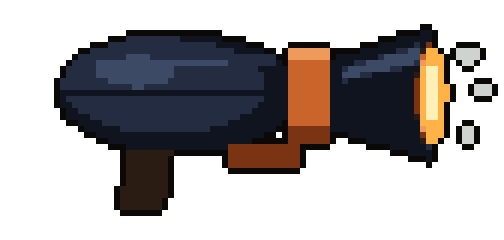

- **Deliver:** `icons/bombardier.png` and `held/bombardier.png`. Primary slot. The held sprite ends up about 104 px long in the game's atlas (the pistol is 46, the shotgun 116, the hunting rifle 137).
- **Look:** A short, fat shotgun. The housing is made of blue-black beetle wing cases with a centre seam, then an orange collar, then a wide flared dark muzzle glowing orange-hot inside. Small steam puffs at the muzzle (icon only). Dark grip.
- **In the game:** A short cone of boiling spray, 260 px. Sets bugs alight and shoves them back.


### Hornbreaker

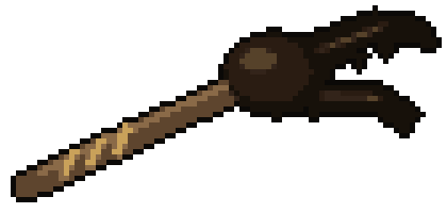

- **Deliver:** `icons/hornbreaker.png` and `held/hornbreaker.png`. Melee slot. The held sprite ends up about 124 px long in the game's atlas (the pistol is 46, the shotgun 116, the hunting rifle 137).
- **Look:** A two-handed hammer: a long wooden haft with bronze wrapping, and a head made of a dark chitin block with a forked Hercules-beetle horn.
- **In the game:** A slow hammer. Every hit sends a shock line 300 px forward that knocks a column flat.


### Lure Lantern

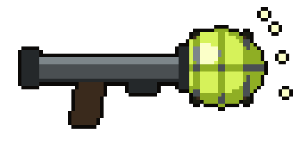

- **Deliver:** `icons/lure_lantern.png` and `held/lure_lantern.png`. Sidearm slot. The held sprite ends up about 70 px long in the game's atlas (the pistol is 46, the shotgun 116, the hunting rifle 137).
- **Look:** A launcher: a plain grey metal tube with a grip, ending in a caged glass cup that holds a glowing yellow-green firefly lantern (#d6f25a), with a few sparks around it (icon only).
- **In the game:** Lobs a glowing lure. Every ordinary bug within 500 px attacks it for 6 seconds, then it bursts for 120 damage.


### Mantis Scythes

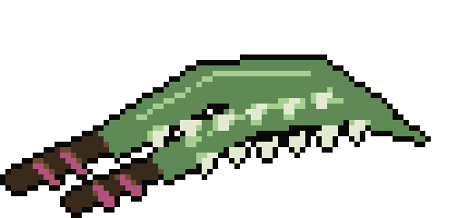

- **Deliver:** `icons/mantis_scythes.png` and `held/mantis_scythes.png`. Melee slot. The held sprite ends up about 100 px long in the game's atlas (the pistol is 46, the shotgun 116, the hunting rifle 137).
- **Look:** A pair of curved green mantis forearm blades with pale serrations along the inner edge, each on a short dark handle wrapped in magenta cloth. Icon: the pair crossed. Held sprite: the two blades side by side, both pointing right.
- **In the game:** Fast twin blades with a wide arc. Each swing steps you forward. Double damage from behind, and a little health back per hit.


### Carrion Hive

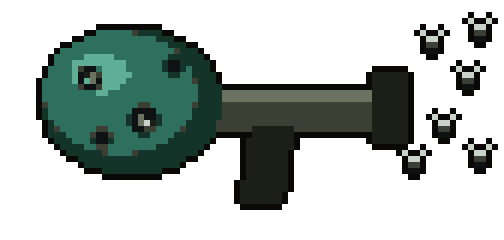

- **Deliver:** `icons/carrion_hive.png` and `held/carrion_hive.png`. Primary slot. The held sprite ends up about 112 px long in the game's atlas (the pistol is 46, the shotgun 116, the hunting rifle 137).
- **Look:** A launcher with a dull metal body and grip. Its magazine is a dark teal organic pod riddled with holes, with pale maggots at the openings. Small black flies circle the muzzle (icon only).
- **In the game:** Lobs a pod. A cloud of flies hangs for 6 seconds, and any bug that dies inside it bursts and hurts the ones beside it.


### Queen's Decree

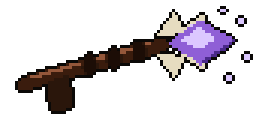

- **Deliver:** `icons/queens_decree.png` and `held/queens_decree.png`. Sidearm slot. The held sprite ends up about 68 px long in the game's atlas (the pistol is 46, the shotgun 116, the hunting rifle 137).
- **Look:** A slim sceptre-like dart gun: a dark chitin shaft with a grip, bone-white crown spikes near the head, and a faceted violet pheromone crystal at the tip (#8f5fd6, highlight #dcc8ff) with faint sparkles (icon only).
- **In the game:** Fires a pheromone dart. The swarm turns on the marked bug for 6 seconds. A marked boss takes 25% more damage instead. You keep it after the ending.


## Item icons

- **`icons/ichor.png`:** Ammo for every insect gun. A small stoppered glass vial of glowing yellow-green ichor (#b6d24a), a little spilled at the lip.
- **`icons/royal_jelly.png`:** A healing item. One waxy six-sided comb cell used as a cup, filled with pearly white-gold jelly with a soft glow.
- **`icons/carapace_vest.png`:** Body armour: a vest cut from a dark brown beetle plate with a pale bronze rim, with leather straps and buckles. Same view as the existing vest icons.

These use the same icon prompt as the weapons, with the object text swapped.

## Optional: the hive itself

Not needed for the first playable. The floor, rock walls and glow are drawn by code, the way the city's ground tiles are.
If you want painted props, these are the ones the map uses. All are seen from directly above on a transparent background.

- **`props/burrow.png`:** Burrow mouth in the floor against a wall: a ragged dark hole with a raised rim of chewed earth. Two states: open, and collapsed (filled with rubble).
- **`props/egg_cluster.png`:** A cluster of eight to twelve pale oval eggs stuck together with resin. Two states: intact (faint violet glow inside), and hatched (torn empty skins).
- **`props/resin_seal.png`:** The sealed door between cells: a wall of amber resin with a darker web of veins. Three states: sealed, cracking, dissolved to a puddle.
- **`props/royal_lock.png`:** One of the six locks on the Queen's chamber: a fist-sized amber node set in the wall. Two states: lit amber, and dark.
- **`props/cocoon.png`:** A silk cocoon hanging against a pillar, seen from above as a pale spindle. Two states: closed, and cut open.
- **`props/steam_vent.png`:** A cracked vent in the floor with an orange glow below. Two states: idle, and firing (the steam itself is drawn by the game).
- **`props/fungus_row.png`:** A low row of pale green fungus caps, one tile long, tileable end to end. Two states: whole, and eaten down to stubs.
- **`props/corpse_heap.png`:** A heap of insect carcasses and dragged-down debris. Two states: fresh, and burned to a black mound.
- **`props/jelly_conduit.png`:** A pulsing organic pipe node the height of a person, pale gold, feeding the Queen. Two states: intact, and burst.
- **`props/rift.png`:** The rift: a ragged vertical tear of violet-white light, seen from above as a lens shape with a bright core. Four animation frames.

Cell colours, for anything painted to sit in a particular cell: Warrens amber-brown `#7a5530`, Granary moss green `#5c7038`,
Paper Hive straw yellow `#9a8840`, Boiling Galleries ember `#8a4426`, Lantern Deep dark teal `#28505c`, Rot Cellar grey-violet `#5a4a66`,
Royal Cell violet `#6a44a8`.

## The prompts

`prompts.json` holds one complete, ready-to-send prompt for each of the 44 images, under `assets[].prompt`, with the
file to deliver and the references to attach beside it. Every prompt is the same shared rules (camera, subject, style,
background, layout) followed by that asset's own lines from this file. As an example, this is the Drone's:

```text
Use case: stylized-concept.
Asset: production overhead pixel-art animation sprite sheet for DEAD ZONE, a Phaser top-down zombie game.
Reference image 1 (art/source/zombies-pixel/walker-0.png) is the STYLE reference: match its camera, facing, grid, pixel-art rendering and level of detail. Reference image 2 (art/source/hive-pixel/concepts/enemy-drone.png) is the DESIGN reference for the new creature: its silhouette, anatomy, colours and markings. Reference image 3 (art/source/hive-pixel/concepts/enemy-drone-walk.png) shows the movement cycle. The design references are low resolution on purpose; paint the creature at the quality of image 1.
CAMERA IS CRITICAL: orthographic, straight DOWN from directly above at 90 degrees. You see the creature's back: the top of the head, thorax and abdomen, the wing cases, with the legs splayed out to both sides. Every pose faces screen RIGHT (+X): head on the right, abdomen on the left. Never a side view, front view, three-quarter view or isometric view.
WHAT IT IS: a giant dead insect the size of a person, from an underground hive. It is an insect on six legs. It is not a humanoid and not a human wearing insect parts. It is a reanimated corpse: dull chipped chitin, hairline cracks, a patch of grey-green rot, a frayed wing or a missing leg tip. Every creature from the rift has small glowing violet eyes (#c9a6ff). Keep them visible in every living frame and dark in the corpse.
STYLE: detailed crisp pixel art that matches the style reference: dark pixel outlines, a limited shaded palette, clean readable pixel clusters. Light from the upper left. No blur, no soft glow, no 3D render, no painterly smoothing.
BACKGROUND: true alpha transparency. No floor, no cast shadow, no checkerboard, no text, labels, numbers, grid lines, borders, UI or props. No loose projectiles, sprays or particles unless the pose list asks for them.
LAYOUT: a wide 2:1 canvas, ideally 2048x1024. EXACTLY 8 columns and 4 rows of equal square cells. Invisible grid. Each sprite is centred on the middle of its thorax in its cell, at an identical body scale in every cell. The whole creature, including legs, antennae and wings at their widest, stays inside the central 70% of its cell. Nothing overlaps a cell boundary. Do not fill the empty cells. 29 poses:
ROW 1 cells 1-8: WALK frames 0-7. Brisk tripod gait, antennae twitching. Insects walk in an alternating tripod: the front and rear leg of one side move together with the middle leg of the other side.
ROW 2 cells 1-6: ATTACK frames 0-5: wind-up, rear back, lunge, full strike, retract, recover. Lunging bite, mandibles snapping shut. Cells 7-8: HIT frames 0-1: recoil and recovery.
ROW 3 cells 1-8: DEATH frames 0-7, staying faced to the right. Legs fold, it tips onto its side and then its back. The last frame is completely motionless.
ROW 4 cell 1: CORPSE: the same pose as death frame 7, eyes dark, with a small dark stain of ichor underneath.
ROW 4 cells 2-5: SPECIAL frames 0-3. ALARM. It rears the front of its body, antennae raised and spread wide, mandibles open, held with a slight tremble.
ROW 4 cells 6-8: completely empty and transparent.
CREATURE: Drone, a worker ant. Worker ant the size of a person. Three clear body segments: a round head with short open bone-white mandibles and elbowed antennae, a narrow thorax, and a large oval abdomen with faint darker bands. Six thin dark legs splayed from the thorax. Rust-brown chitin (#7a4326, highlight #a8643c, shadow #40200f), near-black legs (#2b160b). Signs of death: a patch of grey-green rot (#7d8f45) on the abdomen, hairline cracks, one antenna shorter than the other.
```

## Before handing a sheet over

- The background is really transparent: no white matte, grey haze or painted checkerboard. If it is not, run the `cleanup_prompt` in `prompts.json`.
- The grid is exact and nothing crosses a cell boundary.
- Every cell has the same body scale and centre point.
- Every pose faces right, including the corpse.
- The violet eyes are there in every living frame.
- The file name matches the table at the top.

When sheets arrive, record what was actually used in `prompts.json` so the set can be rebuilt, as the other art folders do.
