# DEAD ZONE: The Hive Below (third story)

**Status:** signed off by Nate on 2026-11-11. Nothing is built yet.
The proposal page, with the animated concepts and the sign-off record: https://claude.ai/artifact/EBwWYX2tQwybzWcf8EgG7B
Art brief for the image model: [`art/source/hive-pixel/README.md`](../art/source/hive-pixel/README.md)

A rift opens in the drained reservoir at North Ridge and a swarm comes through. You go down into a hive of seven
chambers, kill the six brood bosses that seal the royal cell, and then kill the Queen. One new map the size of
Bellwether, 11 enemy types, 7 bosses, 11 weapons, 10 missions.

The Long Road and A Group in Need are not touched. This is a third tab under Story, on its own map, playing by the
same rules: missions with one objective at a time, a checkpoint at the end of each, death restarts the mission,
walk-over pickups, XP and the skill tree. No building, no crafting.

## What was signed off

Nate kept all 37 items (8 places, 11 enemies, 7 bosses, 11 weapons). Nothing was cut or marked for change.

| Decision | Choice | Notes |
|---|---|---|
| Name | The Hive Below |  |
| What the creatures are | Giant dead insects on six legs |  |
| When it can be played | **Locked until A Group in Need is finished** | Changed by Nate. The survivor, level, skills and gear carry over from A Group in Need, the way that story carries them over from The Long Road. The F9 testing panel gets an unlock button like the existing one. |
| The rescued four | Ada, Ben, Kit and Lewis fight beside you in two hold-outs |  |
| The art | **Painted by an image model that Nate runs** | Changed in chat after sign-off (the page still shows "drawn by code"). The brief is `art/source/hive-pixel/README.md`. Assumption to confirm: the build uses code-drawn stand-ins until painted sheets arrive, in the same sheet layout, so painted sheets replace them with no code change. |
| Build order | Four playable steps, starting with the Breach and the Warrens |  |
| A Light in the Valley's code | Delete the story's own files and tests in step 1; keep the engine the other modes share | The tab is already off the title screen (done 2026-11-11). |
| Version control | **Yes: git, in a repository called `zombies` under Nate's account** | Nate's note: "add it under my account and call it zombies". First commit before any build work. `.env` is already in `.gitignore`. Assumed private unless Nate says otherwise. |

## Premise

North Ridge has been quiet since you brought Ada, Ben, Kit and Lewis home. Then the reservoir behind the dam drains
in one night. In the mud where the water was there is a tear that glows violet, and things are climbing out of it:
insects the size of people, dead, and still moving.

Eli works out that the tear is being held open from the far side. June starts a new map. Mara stays at the dam with
the wounded and Ruth stays on the radio. You are still the one with the gun, so you go down.

The cast is the one from the other two stories. Mara, Eli, June and Ruth talk you through every mission. Ada, Ben,
Kit and Lewis hold the checkpoint camps behind you and fight beside you in two hold-outs.

## Rules of the hive

- **Seven cells, one comb.** Six brood cells in a ring around the royal cell. The route runs clockwise through all six, then into the middle.
- **Seals.** Each brood cell's boss seals the door out. Kill it and the seal dissolves, a checkpoint camp goes up at the door, and one of the six locks on the Queen's chamber goes dark.
- **Burrows.** Bugs pour out of burrow mouths in the walls, where you can see them coming. A burrow has health: collapse it and that source stops. "Clear the area" objectives become "collapse the burrows".
- **Always dark.** No daylight. You have your flashlight and the glow of each cell's fungus or resin, a different colour in each. One cell has no glow at all.
- **Ichor.** Bugs drop ichor, the ammo for every insect gun. The more they swarm, the more you can shoot. Normal guns still work and still need bullets, which come from crates the hive has dragged down from the city.
- **Eggs and grubs.** Egg clusters hatch grubs if you linger near them. A grub left alive long enough comes back as an adult.

## The map

The Hollow is 16,000 by 16,000, the same world size as Bellwether. The layout below came out of a first version of the
level builder (200 by 200 tiles of 80 px, a different carving style per cell, every cell checked to be one connected
space, route found by shortest path). It is a first pass: landmark rooms get placed by hand in the build. The main route
is about 47,000 px end to end; the Long Road's line from gate to gate is about 46,000.

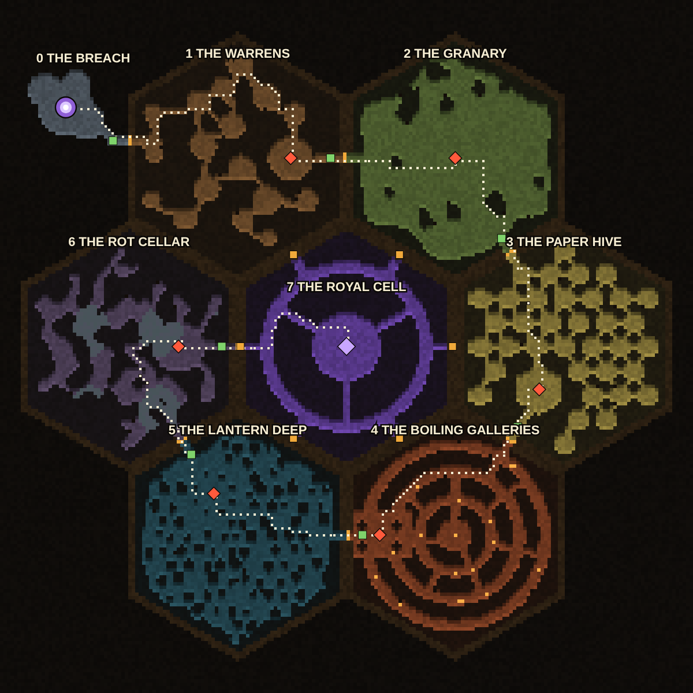

Red diamonds are boss arenas, the violet diamond is the Queen, green squares are checkpoint camps, amber marks are
sealed doors and the six locks, the dotted line is the mission route.

| # | Place | Lives here | Light | Boss | Main path |
|---|---|---|---|---|---|
| 0 | **The Breach** | Drone, Hopper | Floodlights and moonlight | none | ~2,100 px |
| 1 | **The Warrens** | Drone, Honeypot, Grub | Amber resin light | The Marshal | ~9,000 px |
| 2 | **The Granary** | Hopper, Shrieker, Drone | Green fungus light | Famine | ~6,500 px |
| 3 | **The Paper Hive** | Stinger, Honeypot, Grub | Yellow, through paper | Matriarch Vespa | ~6,100 px |
| 4 | **The Boiling Galleries** | Spitter, Shieldback, Drone | Orange vent glow | Goliath | ~6,200 px |
| 5 | **The Lantern Deep** | Lurker, Dustwing, Skitterer | None. A few blue glow-worm threads. | The Prioress | ~6,200 px |
| 6 | **The Rot Cellar** | Skitterer, Grub, Honeypot | Dim grey-violet | The Carrion Lord | ~6,200 px |
| 7 | **The Royal Cell** | Every type | Violet rift light | The Queen | ~4,200 px |

**0. The Breach** (open air). The drained reservoir bed at North Ridge, at night. The dam wall is behind you and the rift is in the mud ahead. Small on purpose: one hold-out to learn the numbers, then you go through. Hazards: None yet.

**1. The Warrens** (ants). Small brood chambers joined by narrow, winding tunnels. You are always one corner from the next column, and a tunnel mouth is the only place you can hold a line. Hazards: Burrows in the tunnel walls. Egg nurseries.

**2. The Granary** (locusts and cicadas). One vast open cavern planted with rows of fungus. The rows are low cover: you shoot over them and Hoppers jump over them. There are no walls to put your back against, only rock pillars. Hazards: Locust clouds that sweep the floor in marked lanes.

**3. The Paper Hive** (wasps). A comb of small six-sided rooms with paper walls. Bullets go through the paper and fire burns it, so you can open your own doors. The gaps between some rooms are pits: Stingers fly across, you take the bridges. Hazards: Comb cells that hatch Stingers unless you shoot them first.

**4. The Boiling Galleries** (beetles). Three ring galleries around a core of steam vents, wide enough for a Shieldback to build up a charge. The vents fire on a rhythm and scald bugs as badly as they scald you. Hazards: Steam vents on a timer. Boulders rolled down the straight connectors.

**5. The Lantern Deep** (mantises and moths). A forest of thin rock pillars in total darkness. Your flashlight is the only real light, and it calls every moth in the cell. Lurkers stand against the pillars and wait for you to walk past. Hazards: The dark. Silk cocoons: some hold supplies, some hold a Lurker.

**6. The Rot Cellar** (flies and roaches). Low, blobby cellars half under water, where the hive keeps what it has killed. Wading slows you down, and roach holes in the walls let Skitterers come out behind you. Hazards: Corpse heaps that hatch grubs unless burned. Water halves your speed.

**7. The Royal Cell** (the queen and her guard). A guard ring around the throne chamber, with six sealed alcoves facing the six brood cells. Every type you have met is here at once. The rift is anchored under the Queen. Hazards: All of the above, together.

## The swarm

Every bug is the size of a current zombie, between a crawler and a brute. There are about three times as many around
you, and they arrive in groups.

- The Long Road keeps about 39 roaming zombies alive around you and adds them one at a time, out of sight.
- The Hive keeps up to about 120, sent in columns of 8 to 20 from burrows you can see.
- It stays fair because the fodder dies in one or two shots, most insect weapons hit groups, ichor drops keep ammo coming, and Honeypots and vents hurt or stall the bugs as much as you.
- The cap has to be measured. The zombie code already sorts neighbours into a grid, but nothing has run at this size. Record 150 and 200 on screen with the F8 recorder before fixing the cap at 120.

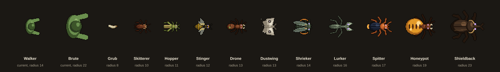

## Enemies

Health, speed and hit numbers are starting points set against the current zombies, to be tuned in play. For reference:
walker 38 health, 65 speed; runner 25, 135; brute 160, 43; crawler 20, 92; bloater 78, 48.

| Enemy | Insect | Role | Radius | Health | Speed | Hit | First met |
|---|---|---|---|---|---|---|---|
| **Drone** | Worker ant | Fodder | 13 | 24 | 82 | 7 | The Warrens |
| **Hopper** | Locust | Fodder that jumps | 11 | 18 | 105 | 6 | The Granary |
| **Honeypot** | Honeypot ant | Walking hazard | 19 | 75 | 45 | 10 | The Warrens |
| **Shrieker** | Cicada | Caller | 14 | 45 | 55 | 6 | The Granary |
| **Stinger** | Wasp | Flier | 12 | 28 | 120 | 8 | The Paper Hive |
| **Spitter** | Bombardier beetle | Ranged | 17 | 65 | 50 | 16 | The Boiling Galleries |
| **Shieldback** | Rhinoceros beetle | Tank | 23 | 230 | 44 | 28 | The Boiling Galleries |
| **Lurker** | Praying mantis | Ambusher | 16 | 95 | waits, then 320 | 32 | The Lantern Deep |
| **Dustwing** | Moth | Light-seeker | 13 | 30 | 95 | 5 | The Lantern Deep |
| **Skitterer** | Cockroach | Flanker | 10 | 22 | 145 | 5 | The Rot Cellar |
| **Grub** | Larva | Hatchling | 8 | 12 | 95 | 4 | The Rot Cellar |

### Drone

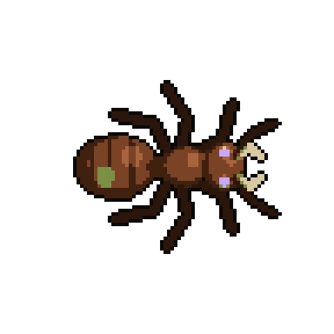

Worker ant. Fodder. A walker with a third less health, a little faster. Columns of 8 to 14.

- **Alarm pheromone:** The first drone to see you marks you. Every drone within 600 px joins in and none of them lose your trail for 12 seconds. Five or more together move 20% faster.
- **How you beat it:** Kill the scout before it reaches the others. Fight at tunnel mouths.

### Hopper

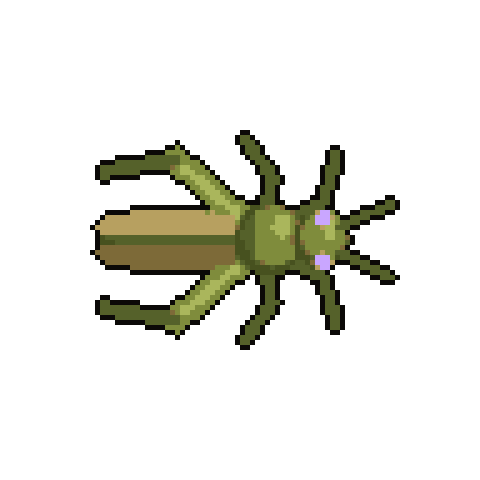

Locust. Fodder that jumps. A runner, slower on foot. Clouds of 12 to 20.

- **Leap:** Jumps up to 280 px over other bugs and low cover to land beside you, every 2.5 seconds. It can be shot in the air.
- **How you beat it:** Keep moving sideways. Use spread weapons. A chokepoint will not hold them.

### Honeypot

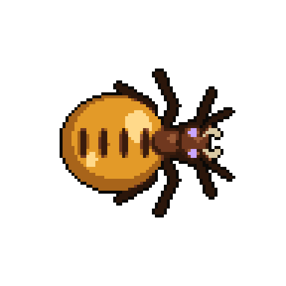

Honeypot ant. Walking hazard. The bloater, with honey instead of an explosion. One or two inside a column.

- **Honey burst:** Bursts on death into a pool of honey, 110 px across for 7 seconds, that halves movement speed. Yours and the bugs'.
- **How you beat it:** Pop it while the column is walking past and the whole column bogs down. Never pop it at your feet.

### Shrieker

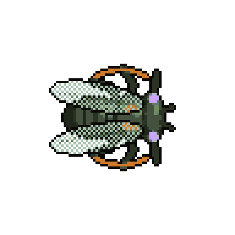

Cicada. Caller. New. Nothing in the game does this now. Alone, behind the others.

- **Chorus:** Hangs back. After a 1.2 second wind-up it screams: every bug within 900 px comes for you and moves 25% faster for 6 seconds. Your flashlight flickers.
- **How you beat it:** Kill it first. The glow during the wind-up gives its position away.

### Stinger

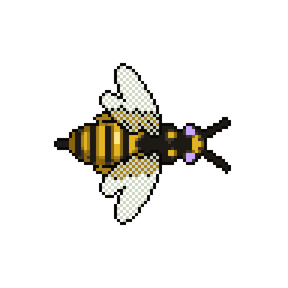

Wasp. Flier. A runner that ignores the floor. Flights of 4 to 8.

- **Flight and venom:** Flies over pits, low cover and other bugs. Each sting adds a venom stack: 3 damage a second for 4 seconds, up to 3 stacks.
- **How you beat it:** Back into a tunnel so they come from one direction. Shotguns and the Bombardier.

### Spitter

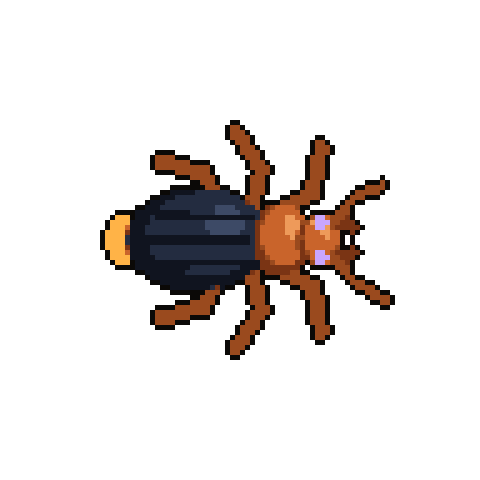

Bombardier beetle. Ranged. New. The first ordinary enemy that attacks from range. Two or three behind a column.

- **Boiling spray:** Plants its legs at 220 px and, after a 0.6 second tell, fires a 60° cone of scalding spray. The puddle burns for 2 seconds.
- **How you beat it:** Sidestep during the tell. It cannot turn while spraying, so hit it from the side.

### Shieldback

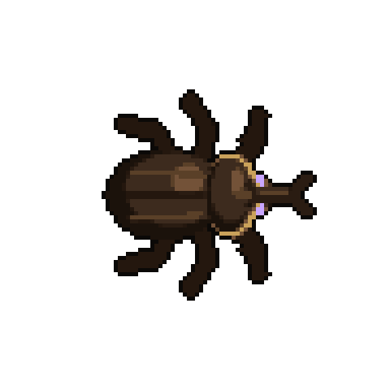

Rhinoceros beetle. Tank. The brute, with armour on the front. One at the head of a column.

- **Front plate and charge:** Shots to its front do 20% damage. It lowers its horn and charges in a straight line at 300 speed, shoving other bugs aside.
- **How you beat it:** Flank it, burn it, or corrode it: acid strips the plate. Dodge the charge and shoot its back.

### Lurker

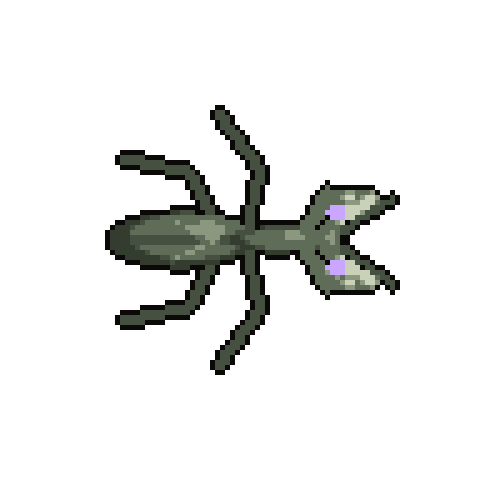

Praying mantis. Ambusher. New. It does not chase; it waits. Alone.

- **Camouflage:** Stands motionless against a wall, almost invisible until your flashlight beam is on it or you come within 170 px. Then it lunges at 320 speed. It is exposed for 1.5 seconds after a miss.
- **How you beat it:** Sweep the walls with your beam before you walk past. Listen for the click.

### Dustwing

Moth. Light-seeker. New. It reacts to your flashlight. Drifts in by threes and fours.

- **Drawn to light:** Homes on your flashlight. Switch it off and it loses you in 2 seconds. If it reaches you or dies close by, its dust cuts your beam's range by 40% for 6 seconds.
- **How you beat it:** Kill it at range, or go dark and let it drift past.

### Skitterer

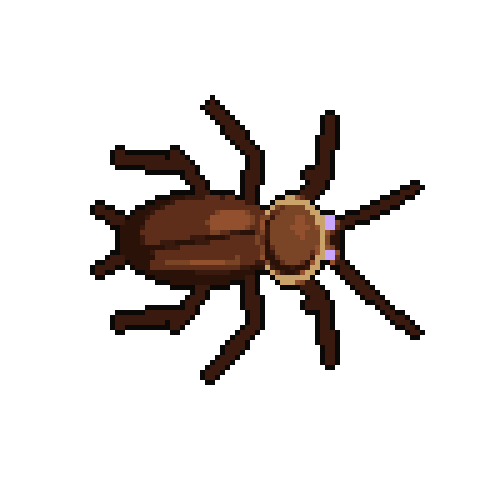

Cockroach. Flanker. A runner that avoids your light. Scatters of 6 to 10.

- **Light-shy, hard to kill:** Runs out of your beam and circles round to come at you from the dark. One in three gets back up after 2 seconds unless it died to fire, acid or an explosion.
- **How you beat it:** Fire and acid. Keep your back to a wall.

### Grub

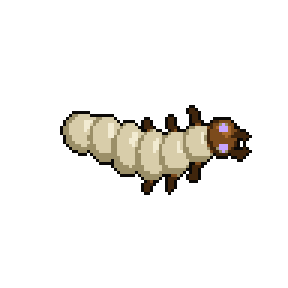

Larva. Hatchling. The crawler, weaker. Hatches three or four at a time.

- **Metamorphosis:** Hatches from egg clusters and infested corpses. A grub left alive for 25 seconds burrows and comes back as a random adult.
- **How you beat it:** Kill them early. Burn eggs and corpses before they hatch.

## Bosses

These sit on the existing boss system: specials with a warning before they land, rage below half health, and a trophy
weapon on death. Today's bosses run from 3,200 health (Howler) to 6,500 (Juggernaut); the Warden has 26,000.

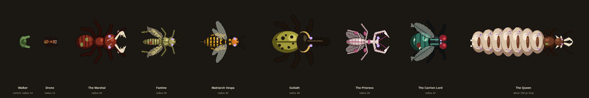

### The Marshal

Soldier ant, boss of The Warrens. Radius 40, 5,000 health. Drops the Mandible Shears.

- **Jaw charge:** A straight lane, marked before it goes. If it hits a wall it is stunned for 1.4 seconds.
- **Rally:** A pheromone burst. Two columns of eight Drones march in and every Drone in the arena speeds up.
- **Formic arc:** Sprays a 90° cone of acid that leaves pools on the floor.
- **Rage:** Below half health it charges twice in a row.
- **How you win:** Make it charge into a wall, then unload.

### Famine

Locust, boss of The Granary. Radius 34, 4,500 health. Drops the Locust Repeater.

- **Skyfall:** Leaps out of sight. A shadow marks where it lands, and the landing throws a shockwave ring.
- **Swarm front:** A wall of locusts sweeps a marked lane across the cavern. Stand in the gap or behind a pillar.
- **Strip:** Eats the fungus rows you are using for cover, so the arena opens up as the fight goes on.
- **Rage:** Below half health it leaps three times in a row.
- **How you win:** It is stuck in the ground for a moment after each landing.

### Matriarch Vespa

Hornet, boss of The Paper Hive. Radius 36, 5,200 health. Drops the Vespiary.

- **Strafing run:** Flies a marked lane across the room, firing stingers down it.
- **Venom volley:** Lobs three globs that become venom pools.
- **Hatch:** Three comb cells in the arena wall light up. Shoot them within 5 seconds or each one releases four Stingers.
- **Rage:** Below half health she lands and adds an impaling dash.
- **How you win:** She hovers still while the comb cells hatch.

### Goliath

Hercules beetle, boss of The Boiling Galleries. Radius 48, 7,500 health. Drops the Hornbreaker.

- **Ram:** A charge. Dodge it so the horn buries itself in a pillar: stuck for 2.5 seconds, and its soft back takes double damage.
- **Boiling vent:** Turns and sprays a wide scalding cone behind it, so you cannot camp its back.
- **Shell quake:** A line of eruptions racing toward you.
- **Rage:** Below half health the pillars shatter on the first hit, so each one only saves you once.
- **How you win:** Shots to the front do 15%. Everything depends on the pillars.

### The Prioress

Praying mantis, boss of The Lantern Deep. Radius 34, 5,000 health. Drops the Mantis Scythes.

- **Vanish:** Invisible outside your flashlight beam. Watch for the shimmer and her footprints.
- **Scythe cross:** Two dash lanes that cross where you are standing.
- **Reap:** A 200° sweep if you stay close.
- **Vespers:** Calls Dustwings to your light.
- **Rage:** Below half health she strikes twice each time she vanishes.
- **How you win:** She is slow to recover after the cross. Keep the beam on her.

### The Carrion Lord

Blowfly, boss of The Rot Cellar. Radius 42, 6,000 health. Drops the Carrion Hive.

- **Infest:** Lays eggs in every corpse in the arena. Five seconds later each one bursts into three Grubs. Burn or blow up the corpses first.
- **Bile flood:** Vomits a puddle that keeps spreading.
- **Buzz dash:** A zig-zag flight across the room.
- **Stench:** A toxic aura, the same as the Plague Lord's.
- **Rage:** Below half health carcasses fall from the roof, giving it more to infest.
- **How you win:** Fewer corpses means a weaker boss. Fire is the best weapon in the room.

### The Queen

Termite and ant queens, final boss, in the Royal Cell. 40,000 across four stages. Drops the Queen's Decree. She is drawn larger than the Warden.

1. **The Court.** She is sealed in resin. Destroy the four jelly conduits around the chamber while the royal guard comes at you. She lobs egg bombs.
2. **The Brood.** The resin cracks. Shoot the egg sac. She lays clutches that hatch into each cell's bugs in turn, and it rains acid.
3. **Unbound.** She tears free of the sac and moves: charge, leap, scream. The rift pulls you toward it.
4. **The Anchor.** She falls across the rift's anchor. Shoot the exposed heart while the roof comes down.

## Weapons

Seven are boss trophies and four are found in the cells. The guns run on ichor; the three melee weapons need nothing.

| Weapon | Insect | Slot | Where it comes from | What it does | Numbers |
|---|---|---|---|---|---|
| **Formic Sprayer** | Ant | Primary | Found in the Warrens | A stream of acid out to 240 px. Every hit adds a corrosion stack that keeps burning. Four stacks strip a Shieldback's plate. | Stream · 80 per tank |
| **Mandible Shears** | Soldier ant | Melee | Dropped by the Marshal | A heavy snap in a narrow arc. A kill cuts through to two more bugs behind it. Ignores armour plates. | 80 damage · 0.6 s |
| **Locust Repeater** | Locust | Primary | Dropped by Famine | Fast automatic. Every shot hops on to two more bugs within 140 px at 60% damage. | 14 damage · 40 per drum |
| **Needler** | Wasp | Primary | Found in the Paper Hive | A semi-automatic rifle. Needles pass through three bugs and inject venom, 30 damage over 4 seconds. | 60 damage · range 1,100 |
| **The Vespiary** | Hornet nest | Sidearm | Dropped by Matriarch Vespa | Fires hornets that home on the nearest bug. It breeds its own: holds 24 and refills 2 a second while holstered, so it never needs ammo. | 12 damage · homing |
| **Bombardier** | Bombardier beetle | Primary | Found in the Boiling Galleries | A short cone of boiling spray, 260 px. Sets bugs alight and shoves them back. | Shotgun class · 5 shots |
| **Hornbreaker** | Hercules beetle | Melee | Dropped by Goliath | A slow hammer. Every hit sends a shock line 300 px forward that knocks a column flat. | 110 damage · 1.0 s |
| **Lure Lantern** | Firefly | Sidearm | Found in the Lantern Deep | Lobs a glowing lure. Every ordinary bug within 500 px attacks it for 6 seconds, then it bursts for 120 damage. | Carry 6 |
| **Mantis Scythes** | Praying mantis | Melee | Dropped by the Prioress | Fast twin blades with a wide arc. Each swing steps you forward. Double damage from behind, and a little health back per hit. | 48 damage · 0.26 s |
| **Carrion Hive** | Blowfly | Primary | Dropped by the Carrion Lord | Lobs a pod. A cloud of flies hangs for 6 seconds, and any bug that dies inside it bursts and hurts the ones beside it. | 25 damage a second · 3 pods |
| **Queen's Decree** | Queen pheromone | Sidearm | Dropped by the Queen | Fires a pheromone dart. The swarm turns on the marked bug for 6 seconds. A marked boss takes 25% more damage instead. You keep it after the ending. | Mark · 6 s |

Also new:

- **Ichor.** Shared ammo for every insect gun. Any bug can drop it; bosses and burrows drop a lot.
- **Royal jelly.** A second healing item. Heals 50 and adds 20% damage for 10 seconds. Found in nurseries, dropped by bosses.
- **Carapace vest.** Body armour cut from a Shieldback, one step above the Military Vest (33% against 30%). Found in the Boiling Galleries.

## Missions

| # | Where | Mission | What you do | Boss |
|---|---|---|---|---|
| 1 | The Breach | **The Water Is Gone** | Reach the floodlights on the dam. Hold the dam wall for 60 seconds against the first swarm. Go through the rift. | none |
| 2 | 1 · The Warrens | **Follow the Column** | Follow the pheromone trail in. Collapse three burrows. Take the Formic Sprayer from a dragged-down supply crate. | The Marshal |
| 3 | 2 · The Granary | **The Choir** | Cross the open cavern. Silence three Shriekers. Hold a rock pillar with the squad while the cloud passes. | Famine |
| 4 | 3 · The Paper Hive | **Paper Walls** | Burn out the brood combs. Find the Needler. Cross the pits to the atrium. | Matriarch Vespa |
| 5 | 4 · The Boiling Galleries | **Pressure** | Time the steam vents. Take the Bombardier. Get down the long gallery past the rolling boulders. | Goliath |
| 6 | 5 · The Lantern Deep | **Lights Out** | Cross the dark with moths on your beam. Find the lantern flares. Cut down three cocoons. | The Prioress |
| 7 | 6 · The Rot Cellar | **What They Keep** | Wade the flooded cellars. Burn the corpse heaps before they hatch. | The Carrion Lord |
| 8 | 7 · The Royal Cell | **Six Seals** | All six locks are dark. Break through the guard ring. Hold the antechamber with the squad while Eli's charge is carried down. | none |
| 9 | 7 · The Royal Cell | **The Queen** | The four-stage fight. | The Queen |
| 10 | Back to the Breach | **Daylight** | The rift is closing. Run the shortcut shaft back to the surface before it shuts, with everything that is left behind you. | none |

## Build order

Before step 1: set up git and the `zombies` repository and make the first commit.

1. **First playable: the Breach and the Warrens.** The foundations: the cave map builder, the cave look (floor, rock, glow lighting), burrows, the bigger swarm spawner, the Story tab and its save slot, the unlock after A Group in Need. Delete A Light in the Valley's own files and tests. Then missions 1 and 2 with Drone, Honeypot, Grub, the Marshal, the Formic Sprayer and the Mandible Shears. This is where Nate judges the swarm size.
2. **The Granary and the Paper Hive.** Leaping, calling and flying enemies; paper walls that can be shot through; pits. Missions 3 and 4 with Hopper, Shrieker, Stinger, Famine, Matriarch Vespa, the Locust Repeater, the Needler and the Vespiary.
3. **The Boiling Galleries and the Lantern Deep.** Armour that has to be flanked, steam vents, enemies that react to the flashlight, the pitch-black cell. Missions 5 and 6 with Spitter, Shieldback, Lurker, Dustwing, Goliath, the Prioress, the Bombardier, Hornbreaker, Lure Lantern and Mantis Scythes.
4. **The Rot Cellar, the Royal Cell and the ending.** Corpses that hatch, the Queen's four stages, the run back to the surface, then a balance pass. Missions 7 to 10 with Skitterer, the Carrion Lord, the Queen, the Carrion Hive and the Queen's Decree.

Each step ships with the same kind of tests the Long Road has: a scripted playthrough of every mission and a check that
the whole route can be walked.

## Notes for whoever builds it

- **Reused:** missions, objectives, checkpoints and saves (`src/sim/road.ts`, `road-data.ts`), the boss kit (`bosses.ts`), flow-field pathing, acid and fire effects, the squad (`road-squad.ts`).
- **New:** the cave builder and its look, burrows, flying and leaping movement, armour facing, light-seeking, and six weapon behaviours (homing, hopping shots, lures, clouds, shock lines, pheromones).
- **Ids used in the art brief**, to keep code and art in step. Enemy types: `drone`, `hopper`, `honeypot`, `shrieker`, `stinger`, `spitter`, `shieldback`, `lurker`, `dustwing`, `skitterer`, `grub`. Bosses: `marshal`, `famine`, `vespa`, `goliath`, `prioress`, `carrion_lord`, `queen`. Weapons: `formic_sprayer`, `mandible_shears`, `locust_repeater`, `needler`, `vespiary`, `bombardier`, `hornbreaker`, `lure_lantern`, `mantis_scythes`, `carrion_hive`, `queens_decree`. Items: `ichor`, `royal_jelly`, `carapace_vest`.
- **Art sheets:** enemy sheets use the zombie layout (8 x 4) plus four "special" frames in row 4, cells 2 to 5, the slot the bloater's pulse frames use today. Boss sheets use the boss layout (4 x 4). The importer should scale each creature to its radius rather than trusting the sheet's scale.
- **The removed story:** `src/sim/campaign*.ts`, `src/ui/campaign.ts`, `src/render/campaign.ts`, their tests and `tools/check-story-legacy.mjs` are what "the story's own files" means. `src/campaign-art.ts` stays: the Long Road draws its gates, camps and cast from it.
- **What could still change:** the swarm cap, if 120 costs too many frames, and every number here once it has been played.
